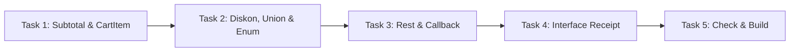

# 📘 Panduan Tugas Latihan TypeScript: Sistem Checkout Belanja

Panduan ini disusun untuk melatih pemahaman TypeScript berdasarkan video:  
📺 **[Tutorial TypeScript Dasar - Programmer Zaman Now](https://www.youtube.com/watch?v=C_C64faSO4c)**

---

## 🎯 Target & Aturan Pengerjaan

1. **Deklarasi Tipe Data adalah Tugas Utama Anda**:
   * Di file `src/types.ts`, Anda wajib mendefinisikan seluruh tipe data, union types, enum, dan interface dari nol.
   * **DILARANG** membiarkan tipe `any`. Seluruh anotasi harus memiliki tipe yang jelas dan ketat (*strongly typed*).
2. **Anotasi Parameter & Nilai Kembalian Fungsi**:
   * Setiap fungsi di folder `src/` harus diberi tipe data parameter dan tipe kembalian (*return type*) yang valid.
3. **Instrumen Pengujian Otomatis**:
   * Jalankan `npm test` kapan saja untuk melihat status pengerjaan Anda (skenario yang sudah lulus atau masih gagal).
   * Jalankan `npm run check` untuk memverifikasi bahwa kode Anda bebas dari *type error*.

---

## 🚀 Perintah Cepat (Commands)

| Perintah | Fungsi | Keterangan |
| :--- | :--- | :--- |
| `npm test` | Menjalankan unit test otomatis | Melihat hasil pengerjaan setiap task |
| `npm run check` | Menjalankan TypeScript type check | Memastikan tidak ada kesalahan tipe data |
| `npm run build` | Men-transpile TypeScript ke JavaScript | Menghasilkan berkas `.js` di folder `dist/` |

---

## 📋 Daftar Tugas Murid (Tasks)



---

### 🔹 Task 1: Tipe Item Belanja & Subtotal (Primitif, Objek, & Array)
* **Referensi Video PZN**: Materi *Tipe Data Primitif*, *Array*, *Object Type*, dan *Type Alias*.
* **Berkas yang Dikerjakan**: `src/types.ts` dan `src/subtotal.ts`

#### Langkah Pengerjaan:
1. Buka [src/types.ts](file:///c:/Users/rplsm/Documents/latihan-git/src/types.ts). Definisikan tipe `CartItem` dengan properti:
   * `name`: bertipe `string`
   * `price`: bertipe `number`
   * `quantity`: bertipe `number`
   *(Gantilah `export type CartItem = any;` dengan definisi tipe yang benar)*
2. Buka [src/subtotal.ts](file:///c:/Users/rplsm/Documents/latihan-git/src/subtotal.ts):
   * Berikan anotasi tipe pada parameter `items` agar bertipe array dari `CartItem` (`CartItem[]`).
   * Berikan return type fungsi berupa `number`.
   * Hapus tipe `any`.
   * Tulis logika untuk menghitung total: jumlahkan `(item.price * item.quantity)` untuk seluruh item.
   * Pastikan mengembalikan `0` jika keranjang belanja kosong.
3. **Uji Pekerjaan**: Jalankan `npm test`. Skenario pada *Task 1* harus berstatus **`[PASS]`**.

---

### 🔹 Task 2: Union Type & Enum Diskon (Type Narrowing)
* **Referensi Video PZN**: Materi *Union Types*, *Enum*, dan *Null & Undefined*.
* **Berkas yang Dikerjakan**: `src/types.ts` dan `src/discount.ts`

#### Langkah Pengerjaan:
1. Buka [src/types.ts](file:///c:/Users/rplsm/Documents/latihan-git/src/types.ts):
   * Buat Union Type `VoucherCode` yang nilainya **hanya** diizinkan `"DISKON10"` atau `"DISKON50"`.
     ```typescript
     export type VoucherCode = "DISKON10" | "DISKON50";
     ```
   * Lengkapi `enum DiscountRate` dengan nilai desimal potongan harga:
     ```typescript
     export enum DiscountRate {
       DISKON10 = 0.10,
       DISKON50 = 0.50,
     }
     ```
2. Buka [src/discount.ts](file:///c:/Users/rplsm/Documents/latihan-git/src/discount.ts):
   * Berikan anotasi tipe parameter:
     * `subtotal: number`
     * `voucherCode?: VoucherCode | null` *(opsional atau boleh null)*
     * Return type: `: number`
   * Tulis aturan diskon:
     * Jika `voucherCode === "DISKON10"`, kurangi subtotal sebesar 10% (bisa memanfaatkan `DiscountRate.DISKON10`).
     * Jika `voucherCode === "DISKON50"`, kurangi subtotal sebesar 50% (bisa memanfaatkan `DiscountRate.DISKON50`).
     * Jika tidak ada voucher atau bernilai `null`/`undefined`, kembalikan `subtotal` utuh tanpa potongan.
3. **Uji Pekerjaan**: Jalankan `npm test`. Skenario pada *Task 2* harus berstatus **`[PASS]`**.

---

### 🔹 Task 3: Fitur Fungsi Lanjutan (Rest Parameter & Callback)
* **Referensi Video PZN**: Materi *Function Parameters*, *Rest Parameter*, dan *Function sebagai Parameter (Callback)*.
* **Berkas yang Dikerjakan**: `src/types.ts` dan `src/calculator.ts`

#### Langkah Pengerjaan:
1. Buka [src/types.ts](file:///c:/Users/rplsm/Documents/latihan-git/src/types.ts):
   * Definisikan Type Alias untuk fungsi promo custom:
     ```typescript
     export type PromoCalculator = (subtotal: number) => number;
     ```
2. Buka [src/calculator.ts](file:///c:/Users/rplsm/Documents/latihan-git/src/calculator.ts):
   * **Bagian A (Rest Parameter)**:
     * Ubah parameter `calculateAdditionalFees` menjadi Rest Parameter bertipe angka: `...fees: number[]`.
     * Berikan return type `: number`.
     * Jumlahkan seluruh elemen di dalam `fees`. Jika array kosong, kembalikan `0`.
   * **Bagian B (Callback Function)**:
     * Berikan tipe parameter pada `applyCustomPromotion`:
       * `subtotal: number`
       * `promo: PromoCalculator`
       * Return type: `: number`
     * Eksekusi callback `promo(subtotal)` dan kembalikan hasilnya.
3. **Uji Pekerjaan**: Jalankan `npm test`. Skenario pada *Task 3* harus berstatus **`[PASS]`**.

---

### 🔹 Task 4: Kontrak Data Transaksi (Interface & Optional Properties)
* **Referensi Video PZN**: Materi *Interface*, *Optional Property*, dan *Integration*.
* **Berkas yang Dikerjakan**: `src/types.ts` dan `src/checkout.ts`

#### Langkah Pengerjaan:
1. Buka [src/types.ts](file:///c:/Users/rplsm/Documents/latihan-git/src/types.ts):
   * Definisikan `interface Customer`:
     * `name: string`
     * `email: string`
     * `isMember?: boolean` *(opsional)*
   * Definisikan `interface OrderReceipt`:
     * `items: CartItem[]`
     * `subtotal: number`
     * `discount: number`
     * `additionalFees: number`
     * `grandTotal: number`
     * `createdAt: Date`
     * `customer?: Customer` *(opsional)*
2. Buka [src/checkout.ts](file:///c:/Users/rplsm/Documents/latihan-git/src/checkout.ts):
   * Berikan anotasi tipe lengkap pada fungsi `processCheckout`:
     * `items: CartItem[]`
     * `voucherCode?: VoucherCode | null`
     * `customer?: Customer`
     * `...additionalFees: number[]`
     * Return type: `: OrderReceipt`
   * Integrasikan fungsi-fungsi sebelumnya:
     1. Panggil `calculateSubtotal(items)` untuk mendapatkan subtotal.
     2. Panggil `applyDiscount(subtotal, voucherCode)` untuk mendapatkan total setelah diskon.
     3. Hitung nominal diskon: `discount = subtotal - totalSetelahDiskon`.
     4. Panggil `calculateAdditionalFees(...additionalFees)` untuk mendapatkan total biaya tambahan.
     5. Hitung `grandTotal = totalSetelahDiskon + totalBiayaTambahan`.
     6. Kembalikan objek yang memenuhi kontrak `OrderReceipt` dengan `createdAt: new Date()`.
3. **Uji Pekerjaan**: Jalankan `npm test`. Skenario pada *Task 4* harus berstatus **`[PASS]`**.

---

### 🔹 Task 5: Validasi Kompilasi & Penyerahan (Final Verification)
1. **Verifikasi Tipe Data**:
   ```bash
   npm run check
   ```
   Pastikan tidak ada error kompilasi dan terminal mengembalikan kode exit 0 tanpa keluhan tipe data.
2. **Verifikasi Seluruh Test**:
   ```bash
   npm test
   ```
   Pastikan tampil pesan:
   `🎉 SELAMAT! SEMUA SKENARIO PENGUJIAN LULUS 100%! (9/9 SKENARIO)`
3. **Build Kode Final**:
   ```bash
   npm run build
   ```
   Pastikan folder `dist/` terbuat dan berisi berkas JavaScript hasil kompilasi bersih.
4. **Commit & Push ke Git**:
   ```bash
   git add .
   git commit -m "feat: implementasi lengkap tipe data & logika checkout typescript"
   git push origin <nama-branch-anda>
   ```

---

## 👨‍🏫 Catatan untuk Guru (Cara Memeriksa Hasil Murid)

Untuk memeriksa pekerjaan murid secara instan:
1. Pindah ke branch atau direktori pengerjaan murid.
2. Jalankan:
   ```bash
   npm test
   ```
   *(Akan langsung menampilkan rekapitulasi poin kelulusan per task)*
3. Jalankan:
   ```bash
   npm run check
   ```
   *(Memastikan murid tidak meninggalkan tipe data implisit atau bertipe `any`)*
